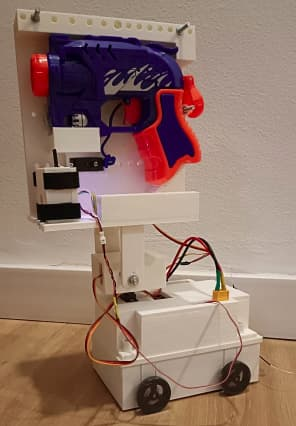
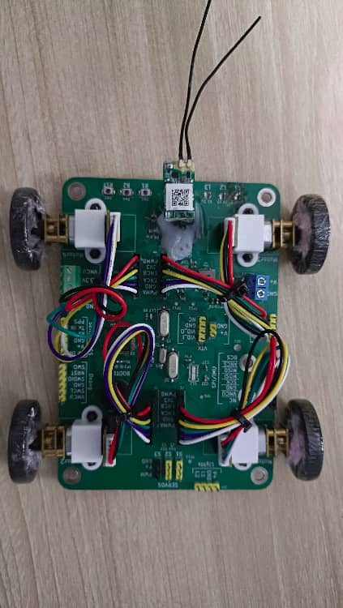
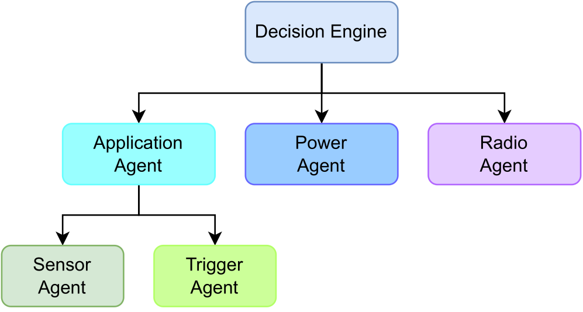

# Projects

My open-source work and projects can be found on my __[GitHub page](https://github.com/ElectronPlant)__.

 

---

## Embedded Systems & Firmware

    <a target="_blank" rel="noopener noreferrer" href="https://github.com/ElectronPlant/beepy_rc" title="BeepyRc">
        BeepyRC
    </a>

__Tags__ `C` `STM32` `FreeRTOS` `custom PCB`

__Description__
Hobby project to make a RC rover platform using spare RC parts. The goal of this project is to develop a complete platform to support long term RC assisted missions. It has its own custom PCB, firmware and mechanical enclosure.

Supported Missions:
1. __Nerf Blaster FPV Rover__: The rover enables you to explore the house remotely using the RC interface and the FPV live feed provided by the video transmitter (VTX). The Nerf blaster and the VTX are mounted on a servo-operated arm, which controls their yaw and pitch angles. The arm provides two extra degrees of freedom to easily explore the room and aim the blaster. Once the target has been acquired, take the shot remotely using the aux channels of the RC remote.

- <figure markdown="span">
{ width="600" }
</figure>
- <figure markdown="span">
{ width="600" }
</figure>
<figcaption>Complete BeepyRC Rover</figcaption>
<figcaption>BeepyRC Hardware</figcaption>

    <a target="_blank" rel="noopener noreferrer" href="https://github.com/ElectronPlant/Self-Aware_Sensor_Node_Architecture" title="Self-Aware Sensor Node Architecture">
        Self-Aware_Sensor_Node_Architecture
    </a>

__Tags__ `C` `Wireless Sensor Networks`

__Description__
Description Base implementation of a hierarchical, agent-based architecture of a self-aware wireless sensor node. This is not the complete wireless sensor node implementation, but a library that can be ported to an existing codebase to support self-awareness. This architecture was developed to support my [Ph.D. Thesis](../research/thesis.md).

The proposed architecture splits the wireless sensor node operation into distinct subtasks (e.g. measurement, wireless transmission, battery management, etc.). Each of these tasks is managed by its own agent, which implements its own Observe-Decide-Act (ODA) loop to monitor and control its assigned task based on its operation requirements. A given task can be split into subtasks also managed by their respective agents creating the hierarchical agent architecture. On the top of the hierarchy lies the Decision agent which is responsible for coordinating the different agents, translating the node level requirements into lower-level agent requirements.

- <figure markdown="span">
{ width="600" }
</figure>
- <figure markdown="span">
{ width="600" }
</figure>
<figcaption>Hierarchical, agent-based architecture</figcaption>
<figcaption>Internal agent structure</figcaption>

    <a target="_blank" rel="noopener noreferrer" href="https://github.com/ElectronPlant/Self-Aware_Sensor_Node_Architecture" title="Self-Aware Sensor Node Architecture">
        Self-Aware_Sensor_Node_Architecture
    </a>

__Tags__ `Arduino` `Custom PCB`

__Description__
Simon Says game implementation for the ATtiny85 MCU. I created this project for three main reasons: 1. I had a 5 euro coupon for a PCB manufacturer that offered PCB fabrication for the same price (so I wanted to see if I could have free custom PCBs). 2. Explore how to port Arduino projects to a cheaper and smaller MCU (in this case the ATtiny85). 3. I wanted to practice SMD soldering. Overall the project was a success, I was able to port the Arduino project to the ATtiny with only minor adjustments to reduce the GPIO usage, and the soldering process was smooth. However, the cost of the PCBs ended up being higher than my coupon so I could not have them for free (+ component costs) :lucide-face-slightly-frowning:

<figure markdown="span">
  { width="300" }
  
Complete assembly of the ATtiny Simon Says game

</figure>

    <a target="_blank" rel="noopener noreferrer" href="https://github.com/ElectronPlant/esp-project-template" title="ESP_Project_Template">
        ESP_Project_Template
    </a>

__Tags__ `C` `ESP-IDF` `ESP32`

__Description__
Template repository for ESP32 projects using ESP-IDF and FreeRTOS and MkDocs documentation. This project showcases a simple FreeRTOS application.

    <a target="_blank" rel="noopener noreferrer" href="https://github.com/ElectronPlant/STM32_Drivers" title="STM32 Drivers">
        STM32 Drivers
    </a>

__Tags__ `C++` `STM32`

__Description__
STM32 Drivers for the MPU-6050 I2C sensors and serial print.

    <a target="_blank" rel="noopener noreferrer" href="https://github.com/ElectronPlant/MPU-6050_Arduino_Library" title="MPU-6050 Arduino Driver">
        MPU-6050 Arduino Driver
    </a>

__Tags__ `Arduino` `STM32`

__Description__
Arduino driver for the MP6050 I2C sensor.

 

---

## Robotics - Computer Vision

    <a target="_blank" rel="noopener noreferrer" href="https://github.com/ElectronPlant/Raspberry_Pi_3B_VSLAM" title="Raspberry_Pi_3B_VSLAM">
        Raspberry Pi VSLAM
    </a>

__Tags__ `Python` `OpenCV`

__Description__
Visual Self-Location And Mapping (VSLAM) algorithm and robot control software for my [B.Sc final project](../research/thesis.md) for the RaspberryPi 3B. The robot a combination of odometry (with the wheel encoders) and custom visual markers to generate a map of its surroundings and locates itself in the map.

<figure markdown="span">
  
  
Robot made as part of my B.Sc final project

</figure>

 

---

## Tools

    <a target="_blank" rel="noopener noreferrer" href="https://github.com/ElectronPlant/file_manager" title="File manager for CLI applications">
        File manager for CLI applications
    </a>

__Tags__ `Rust` `CLI`

__Description__
Simple Tool for CLI applications to load or save a files. With some helpful features to list all the files in the current directory, save files with sequential naming, etc. This is part of a larger personal project, which I published since I found it useful.

